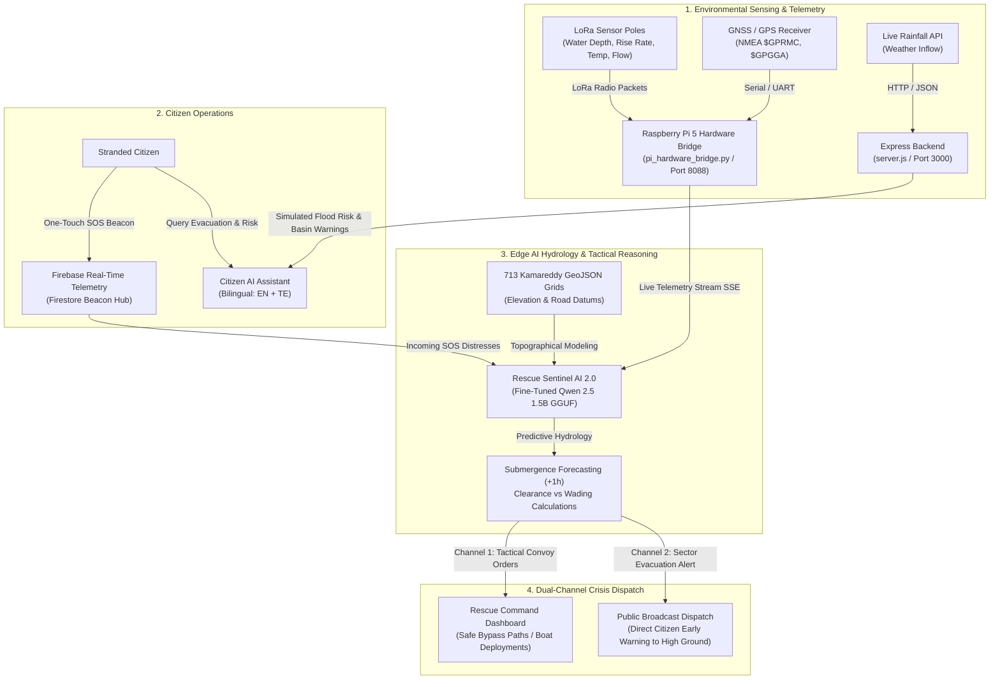
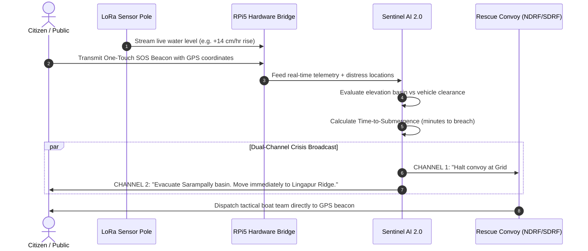

# 🌊 Smart Flood Monitoring and Rescue System
### *Autonomous Disaster Intelligence, Edge IoT Telemetry & Tactical Rescue Operations (FloodGuard AI 2.0)*

[](LICENSE)
[]()
[-green.svg)]()
[]()

---

## 📌 Executive Summary

During sudden cloudbursts and flash flood events, conventional communication infrastructure is frequently crippled, leaving citizens isolated in low-lying basin traps and rescue teams navigating blind through submerged corridors. 

The **Smart Flood Monitoring and Rescue System** (also known as **FloodGuard AI 2.0 / Rescue Sentinel**) is an end-to-end emergency response platform. It unifies **citizen distress signaling**, **real-time LoRa mesh telemetry**, **Raspberry Pi edge computing**, and **tactical AI routing** into a coordinated crisis response ecosystem.

---

## 🔄 End-to-End System Workflow

The following diagram illustrates how telemetry, citizen signals, AI reasoning, and tactical rescue convoys interact in real time:



---

## 🔁 Operational Step-by-Step Lifecycle



---

## 👥 Core Modules & Key Uses

### 1. 🟢 Citizen Emergency Portal (`/Citizen Users`)
*Target: General public and residents in vulnerable flood zones*
* **One-Touch SOS Emergency Beacon**: Instantly transmits distress beacons with live GPS coordinates, battery status, and timestamp to first responders via Firebase.
* **Topographical Flood Risk Simulator**: Evaluates real-time rainfall against municipal elevation grids to alert users whether their neighborhood is in an active drainage trap.
* **Citizen AI Safety Co-Pilot**: Multilingual assistant (English & Telugu) that guides citizens on immediate survival protocols, flood hazards, and safe corridors.
* **Safe Ridge Evacuation Mapping**: Automatically points citizens toward nearby verified high-ground evacuation sectors (e.g., Lingapur Ridge @ 530.9m datum).

---

### 2. 🔴 Tactical Rescue Operations Hub (`/Rescue Users`)
*Target: NDRF, SDRF, disaster response teams, and convoy vehicle operators*
* **Real-Time GIS Tactical Map**: Full-screen situational map displaying active SOS distress signals, submerged sectors, road passability, and convoy positions.
* **Tactical Route Planner**: Generates safe convoy navigation corridors that bypass waterlogged basins, washed-out culverts, and high-velocity river confluences.
* **Dynamic Wading Safety Calculations**: Compares vehicle clearance against live water levels:
  * If $\text{Water Depth} \le \text{Wading Clearance}$: Grants clearance for wheeled convoy ingress.
  * If $\text{Water Depth} > \text{Wading Clearance}$: Halts convoy on high ground and orders motorized boat transition.
* **Offline LoRa Telemetry Monitoring**: Live sensor panel displaying water depth, water rise velocity, ambient temperature, battery voltages, and radio RSSI.

---

### 3. 📡 Raspberry Pi 5 IoT Hardware Bridge (`pi_hardware_bridge.py`)
*Target: Field deployable hardware units on rescue vehicles and command posts*
* **GNSS / GPS Hardware Interfacing**: Decodes raw NMEA sentences (`$GPRMC`, `$GPGGA`) over serial/UART for real-time tracking of field units.
* **LoRa Mesh Transceiver Gateway**: Receives wireless radio packets from solar-powered field poles in remote areas where 4G/5G towers are down.
* **Server-Sent Events (SSE) Server**: Exposes local real-time telemetry streaming at port `8088` for offline browser operations.
* **Hardware Fallback Simulator**: High-fidelity automated sensor simulation mode for development and testing without physical hardware connected.

---

### 4. 🧠 Rescue Sentinel AI 2.0 Engine (`/Rescue Users/ai 2.0`)
*Model: Custom Fine-Tuned Qwen 2.5 1.5B (Quantized Q4_K_M GGUF for Raspberry Pi 5)*
* **Edge-Native Deployment**: Executes entirely offline on Raspberry Pi 5 using `llama-cpp-python` or Ollama with zero reliance on cloud APIs.
* **Predictive Hydrology Forecasting**:
  $$\text{Projected Level (+1h)} = \text{Current Depth} + (\text{Rise Rate} \times 1.15 \text{ if elevation } < 515\text{m})$$
  $$\text{Time-to-Submergence (minutes)} = \frac{\text{Critical Clearance Limit} - \text{Current Depth}}{\text{Rise Rate}} \times 60$$
* **Cloudburst Detection**: Automatically flags inflow acceleration when ambient temperature drops below $24^\circ\text{C}$ accompanied by steep humidity and rapid water rise.
* **Zero-Hallucination Grounding**: Operates strictly within the verified 713 GeoJSON regional elevation grids and verified field landmarks.

---

### 5. 🚪 Central Portal & Authentication (`/Main_starter`)
* **Unified Entry Gateway**: Centralized landing portal for both citizens and rescue coordinators.
* **Authentication Suite**: Secure sign-up, sign-in, and password recovery interfaces.
* **Quick SOS Trigger**: Rapid emergency distress button for immediate beacon activation prior to logging in.

---

## 🗺️ Geospatial Landmark Reference (Kamareddy District)

The system is calibrated using 713 verified GeoJSON topographic elevation grids:

| Sector Name | Grid ID | Elevation | Hazard Classification | Tactical AI Directive |
|:---|:---:|:---:|:---|:---|
| **Sarampally** | `#613` | **502.2 m** | 🚨 Critical Basin | Lowest municipal sink. Deep entrapment; boat extraction mandatory. |
| **Adloor / Adlur** | `#478` | **509.3 m** | ⚠️ Very High Risk | 17.5m below regional datum. Culvert suction trap; divert via East Ridge. |
| **Devanpally** | `#583` | **518.9 m** | ⚠️ High Risk | Stormwater runoff basin; rapid road pooling at bridge junction. |
| **Tekriyal** | `#315` | **519.4 m** | ⚠️ High Risk | River confluence; flow velocity $> 1.5\text{ m/s}$. Avoid small craft. |
| **Municipal Core** | `#356` | **528.3 m** | 🟡 Moderate Risk | Central staging corridor; primary logistics and triage zone. |
| **Lingapur Ridge**| `#396` | **530.9 m** | 🟢 Safe High-Ground | Primary high-ground evacuation ridge and safe transit bypass. |

---

## 🛠️ Technology Stack

| Layer | Component | Technologies |
|:---|:---|:---|
| **User Interfaces** | Citizen & Rescue Portals | HTML5, CSS3 (Modern Glassmorphic UI), JavaScript (ES6+) |
| **GIS Mapping** | Interactive Map & Layers | Leaflet.js, OpenStreetMap Tiles, Custom GeoJSON Boundaries |
| **Edge Hardware** | Field Gateway Unit | Raspberry Pi 5, Python 3, PySerial, NMEA GPS, LoRa Transceivers |
| **Backend Services**| APIs & Grid Loaders | Node.js, Express.js, Server-Sent Events (SSE), Python HTTP Server |
| **Real-time Sync** | Distress & Telemetry | Firebase Firestore SDK (Cloud) + LoRa Mesh (Offline) |
| **Artificial Intelligence** | Edge Hydrology Co-Pilot | Fine-Tuned Qwen 2.5 1.5B (GGUF Q4_K_M), llama-cpp-python, Ollama |

---

## 🚀 Getting Started

### Prerequisites
* **Node.js** (v16.x or newer)
* **Python** (v3.9 or newer)
* **Git**

### Installation

1. **Clone the repository:**
   ```bash
   git clone https://github.com/Jaksani-Abhinav-9/Smart-Flood-Monitoring-and-Rescue-System.git
   cd Smart-Flood-Monitoring-and-Rescue-System
   ```

2. **Install Node.js dependencies:**
   ```bash
   npm install
   ```

3. **Start the Express backend:**
   ```bash
   npm start
   ```
   *The server will start at `http://localhost:3000`.*

4. **Launch the Hardware Telemetry Bridge (Optional / for Rescue Unit):**
   ```bash
   python "Rescue Users/pi_hardware_bridge.py"
   ```
   *Runs on `http://localhost:8088` (auto-engages simulation mode if physical LoRa/GPS is not connected).*

5. **Open the Web Applications:**
   * **Citizen Portal**: Open `Citizen Users/home.html` in your web browser.
   * **Rescue Dashboard**: Open `Rescue Users/home.html` in your web browser.
   * **Main Starter / Login**: Open `Main_starter/main.html` in your web browser.

---

## 📂 Repository Layout

```text
├── Citizen Users/               # Citizen emergency portal & local backend logic
│   ├── ai/                      # Citizen AI agent, prompts, tools, and embeddings
│   ├── alerts/                  # Public alert dispatch & Firebase notifications
│   ├── backend/                 # Express flood simulation server & rainfall check
│   ├── css/                     # Citizen UI stylesheets
│   ├── data/                    # Kamareddy GeoJSON topographic elevation grids
│   └── js/                      # SOS geolocation, Leaflet map, and AI worker scripts
├── Rescue Users/                # Tactical operations hub & first responder tools
│   ├── ai 2.0/                  # Sentinel AI, fine-tuned Qwen model configs & route planner
│   ├── alerts/                  # Rescue alert management interface
│   ├── assets/                  # Icons, emblems, and visual assets
│   ├── css/                     # High-contrast tactical dashboard styles
│   ├── data/                    # Road vectors, grid definitions, and rescue IDs
│   ├── js/                      # Tactical map engine & Firebase listener
│   └── pi_hardware_bridge.py    # Raspberry Pi 5 serial/LoRa/GPS telemetry bridge
├── Main_starter/                # Landing page, authentication suite & quick SOS
├── package.json                 # Project dependencies & startup scripts
└── README.md                    # Project documentation & operational workflow
```

---

## 👤 Author & Maintainer
* **Developer**: [@Jaksani-Abhinav-9](https://github.com/Jaksani-Abhinav-9)
* **Repository**: [Smart-Flood-Monitoring-and-Rescue-System](https://github.com/Jaksani-Abhinav-9/Smart-Flood-Monitoring-and-Rescue-System)
